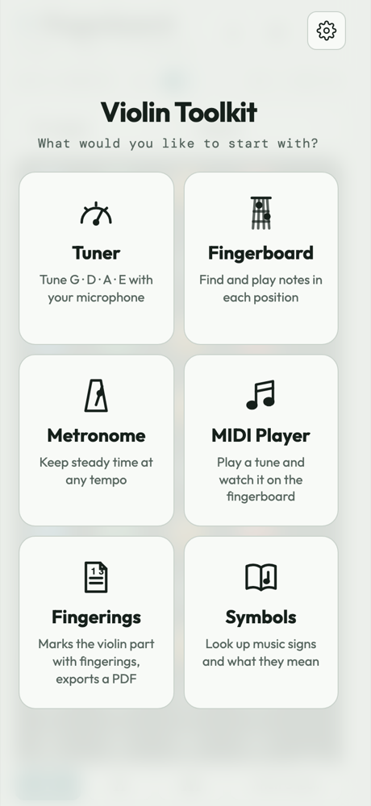
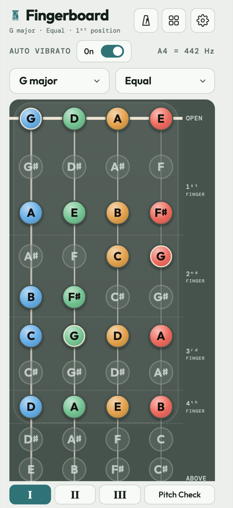
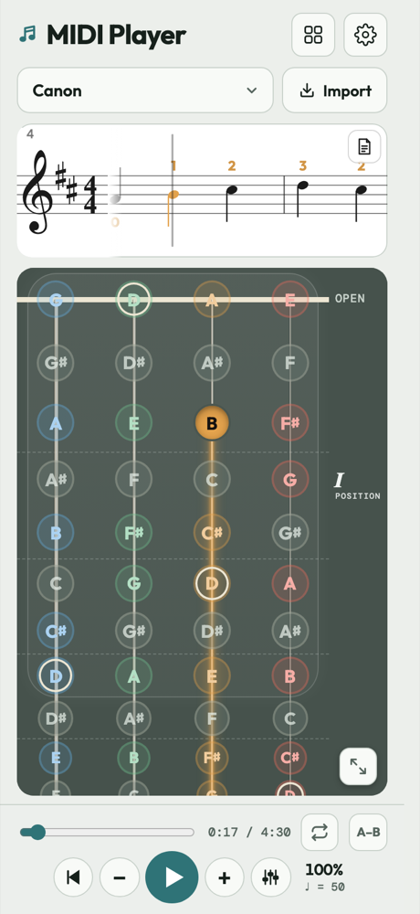
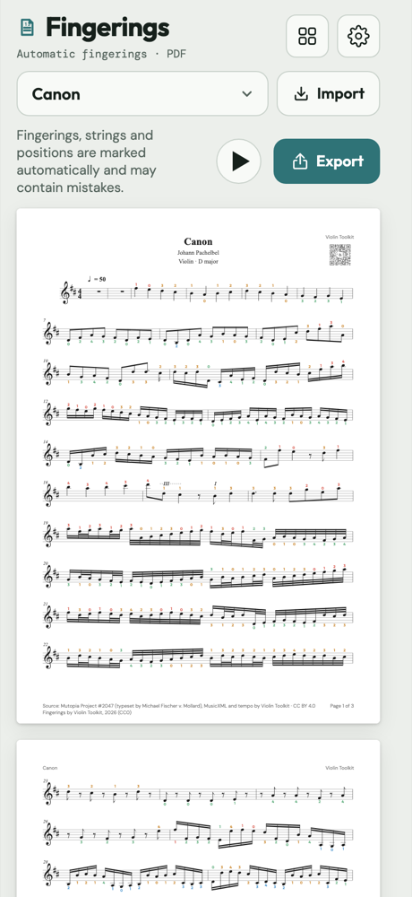
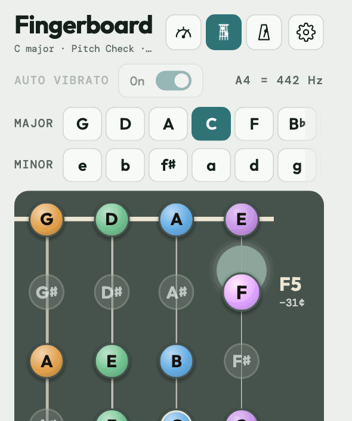

# 🎻 Violin Toolkit

**A free violin practice app: tuner, fingerboard, metronome, MIDI player with 19 tunes, printable fingerings and a music-symbol dictionary.**
No account, no ads. Works offline. On the web, Android and iPhone.

### ▶ [Open the app](https://trix69.github.io/violin-toolkit/) · [Android app](https://trix69.github.io/violin-toolkit/apk/violin-toolkit-android.apk) · [中文说明](README.zh-CN.md)

<p align="center">
  
  
  
  
</p>

## The tools

**Tuner**
- Listens through your microphone. Violin mode finds the string you're playing (G · D · A · E); Chromatic mode shows any note.
- A needle and cents show flat or sharp; within ±3 cents it turns green.
- Reference tones for each string. Tuning pitch from A4 = 380 to 470 Hz (415, 430, 440, 442, 443 one tap away).

**Fingerboard**
- All 12 major and 12 minor keys, notes spelled for the key, outside notes greyed.
- 1st, 2nd and 3rd position with the finger for each note. Equal temperament, just intonation or Pythagorean tuning.
- Press a note to hear it; hold it for 3 seconds and it keeps sounding like a tuning fork.
- **Pitch Check:** play a note and a disc shows where it lands on every string that can play it: on the note when in tune, below when sharp, above when flat.

**Metronome**
- 40–250 BPM on a dial, − / + buttons or tap tempo; any time signature, accent or mute each beat.
- An optional beat flash in your theme colour. Keeps playing while you use the fingerboard.

**MIDI player**
- 19 built-in tunes from Twinkle to Vivaldi's Four Seasons, with accompaniment (see [Score credits](docs/score-credits.md)).
- Import your own MIDI or MusicXML file: the violin part lights up on the fingerboard, the other parts play along.
- A scrolling score with automatic fingerings, positions, bowings and dynamics. Count-in, speed 50–150 %, loop, A–B repeat, mixer (violin, accompaniment, metronome), full screen.

**Fingerings**
- Lays any tune out on A4 pages with fingerings, strings and positions marked, and exports a PDF.

**Symbols**
- 135 music symbols (notes, bowing, dynamics, tempo, ornaments, repeats…). Search, and tap one for what it means.

**Everywhere**
- English or 中文, letter names (C D E) or solfège (Do Re Mi). Light, dark or automatic, five colour themes.
- Practice time: minutes per day while a tool is running, and the number of days you've practised.
- Short first-use tips for each tool (Settings › Help › Show tips again).

<p align="center">
  <br>
  <sub>Pitch Check: above the note when flat, below when sharp, a green ring when in tune.</sub>
</p>

## Get it

- **Web:** [trix69.github.io/violin-toolkit](https://trix69.github.io/violin-toolkit/). Open it once online, then add it to your home screen (iPhone/iPad: Share → Add to Home Screen; Android Chrome: Install app; Mac/PC: Install in Chrome or Edge, Add to Dock in Safari). It then works offline.
- **Android:** [download the app](https://trix69.github.io/violin-toolkit/apk/violin-toolkit-android.apk) (allow installing from your browser when asked). A Google Play version is in testing.
- **iPhone:** an App Store version is on the way; until then use the web app.

The app checks for new versions when it starts and asks before updating (Settings › Automatic update check).

## Privacy

Your settings, practice time and imported files stay on your device, and microphone audio is analysed on the device and never sent anywhere.
The app goes online only to check for a new version, which sends the app version, the kind of app and a random number made on your device so we can count how many copies of each version are in use, and, in the phone apps, to download a built-in tune the first time you play it. No accounts, no cookies, no ads. Full text: [privacy policy](https://trix69.github.io/violin-toolkit/docs/privacy.html).

## Shortcut links

Add these to the address after `#`, separated by commas: `tuner`, `fingerboard`, `metronome`, `symbols`, `midi` or `fingerings` open that tool; `zh` / `en` choose the language; `solfege` / `letter` the note names.
For example [`#fingerboard,zh,solfege`](https://trix69.github.io/violin-toolkit/#fingerboard,zh,solfege).

## Support

If it helps your practice, a ⭐ helps other violinists find it, or you can [buy me a coffee](https://buymeacoffee.com/trinks).
Ideas and bug reports are welcome in [Issues](https://github.com/trix69/violin-toolkit/issues).

## Building from source

Everything in `src/` is built into one HTML page with Python 3:

```
python3 src/release.py
```

This writes `dist/violin-toolkit.html` (not committed) and refreshes `index.html`, `manifest.webmanifest`, `sw.js`, `version.json` and the icons in the repo root, which GitHub Pages serves.

| Path | What it is |
| --- | --- |
| `src/build.py` | Assembles the page: settings, start screen, navigation, update check, privacy screen, tune list and credits |
| `src/tuner.html` | Tuner and the shared pitch detector |
| `src/board.html` | Fingerboard, Pitch Check and the player's board |
| `src/met.*` | Metronome |
| `src/midi.*`, `src/fing.*` | MIDI player (MIDI and MusicXML reader, fingering planner, score) and Fingerings pages |
| `src/sym.*` | Symbols dictionary |
| `src/midi/` | The built-in tunes (MusicXML / MIDI) |
| `src/coach.*` | First-use tips |
| `src/i18n.js` | English / 中文 and solfège |
| `src/make_pwa.py`, `release.py`, `deploy_test.py`, `version.py`, `VERSION`, `PP_VERSION` | Offline app files, build, test site, version numbers, privacy policy date |
| `src/fonts/`, `src/icons/` | Fonts built into the page (nothing loads from Google) and app icons |
| `tools/scores/` | How the built-in tunes were converted from their editions |
| `worker/` | The small Cloudflare Worker behind the update check |
| `docs/` | Privacy policy, score credits, README pictures |

## Licence

The code is under the [MIT licence](LICENSE). The bundled fonts (DM Sans, DM Mono, Outfit) keep the SIL Open Font Licence (`src/fonts/OFL.txt`).
The built-in tunes keep their editions' licences (public domain, CC0, CC BY or CC BY-SA), listed in [docs/score-credits.md](docs/score-credits.md) and in the app under Settings › Help › Score credits.
