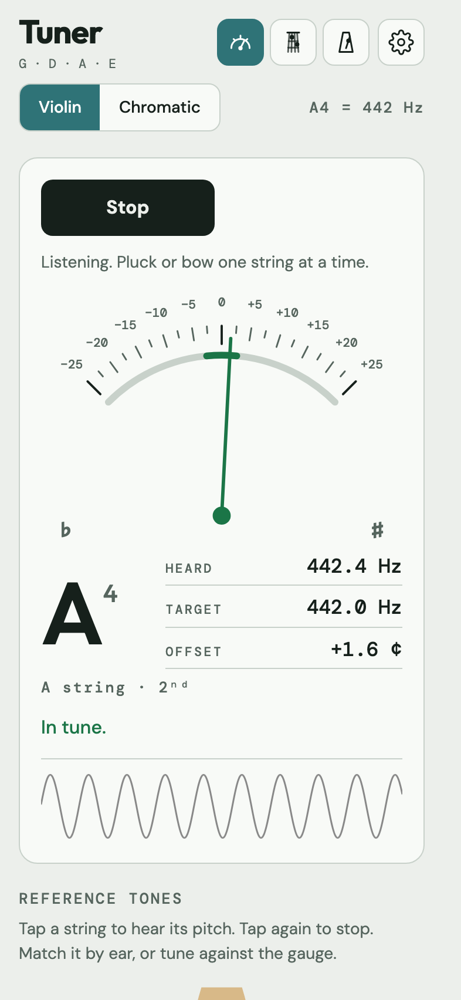
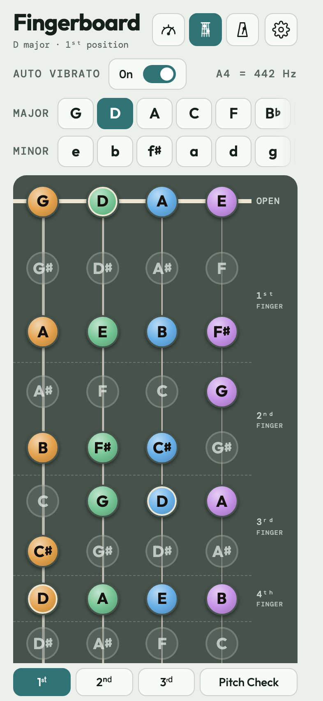
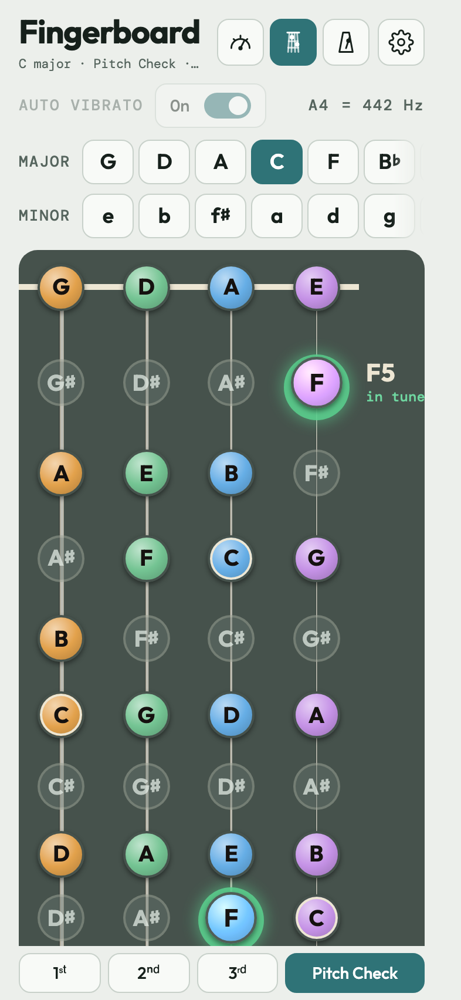
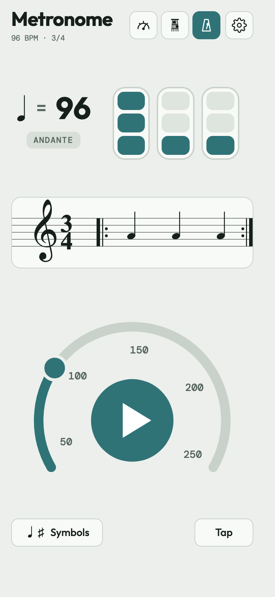

# 🎻 Violin Toolkit

**A free violin practice app: tuner, fingerboard note chart, Pitch Check and metronome on one page.**
No account, no ads, no tracking. Works offline once added to your home screen.

### ▶ [Open the app](https://trix69.github.io/violin-toolkit/)

[中文说明](README.zh-CN.md)

<p align="center">
  
  
  
  
</p>

## What it does

**Tuner**
- Listens through your microphone. Violin mode works out which string you're playing (G · D · A · E); Chromatic mode shows any note.
- A needle and a cents readout show whether you're flat or sharp. Within ±3 cents it turns green and says "In tune."
- Reference tones for each string, and a tuning pitch of A4 = 442 or 440 Hz.

**Fingerboard**
- All 12 major and 12 minor keys. Notes in the key are coloured, the others greyed out, and every note is spelled for its key.
- 1st, 2nd and 3rd position, with the finger that plays each note.
- Press and hold any note to hear it, with optional auto vibrato.

**Pitch Check**
- Play a note and a disc appears on every string that can play it: around the note when you're in tune, below it when you're sharp, above it when you're flat.
- The disc is green when you're close and fades to grey as you drift; the note name and cents show beside the board.

**Metronome**
- 40–250 BPM on a dial, or tap the tempo.
- Tap the time signature to change it, and tap each beat to set accent, medium, normal or muted.
- Keeps playing while you look things up on the fingerboard.

**Everywhere**
- English or 中文, pitch names (C D E) or solfège (Do Re Mi).
- Light, dark or automatic appearance, and five colour themes.
- Short first-use tips for each tool; Settings > Help > Show tips again brings them back.
- Your microphone audio is analysed on your device and never leaves it.

## Install it on your phone

Open the app once while you're online, then:
- **iPhone / iPad (Safari):** Share → Add to Home Screen.
- **Android (Chrome):** menu → Add to Home screen / Install app.
- **Mac / PC:** Chrome or Edge offer "Install" in the address bar; Safari has File → Add to Dock.

After that it opens from the home screen and works without a connection. Settings > "Check for updates" fetches a new version when there is one.

## Shortcut links

Add these to the address after `#`, separated by commas:
- `tuner`, `fingerboard` or `metronome` open that tool straight away;
- `zh` / `en` choose 中文 or English;
- `solfege` / `letter` choose Do Re Mi or C D E.

For example `#fingerboard,zh,solfege`. Language and note-name choices are remembered.

## Support

If it helps your practice, a ⭐ on this repo helps other violinists find it, or you can [buy me a coffee](https://buymeacoffee.com/trinks).
Ideas and bug reports are welcome in [Issues](https://github.com/trix69/violin-toolkit/issues).

## Building from source

The app is built from the files in `src/` into one HTML page. It needs Python 3 only:

```
python3 src/release.py
```

This writes the standalone page to `dist/violin-toolkit.html` (not committed) and refreshes `index.html`, `manifest.webmanifest`, `sw.js`, `version.json` and the icons in the repo root, which GitHub Pages serves. The service worker version is a build timestamp, so every build makes installed copies update.

| File | What it is |
| --- | --- |
| `src/build.py` | Assembles the page: settings, start overlay, navigation, theme script |
| `src/tuner.html` | Tuner, and the shared pitch detector |
| `src/board.html` | Fingerboard and Pitch Check |
| `src/met.css`, `met.html`, `met.js` | Metronome |
| `src/coach.js`, `coach.css` | First-use tips |
| `src/i18n.js` | English / 中文 and solfège translator, ordinal suffixes |
| `src/make_pwa.py` | Manifest, service worker and install page |
| `src/release.py`, `version.py`, `VERSION` | Build and version number |
| `src/fonts/` | DM Sans, DM Mono and Outfit, built into the page (nothing loads from Google) |
| `src/favicon-tags.html`, `src/icons/` | Favicons and app icons |
| `src/redirect/` | Redirect page for the old `violin-fingerboard.html` address |
| `docs/` | README screenshots |

## Licence

The code is under the [MIT licence](LICENSE). The bundled fonts (DM Sans, DM Mono, Outfit) keep their own SIL Open Font Licence, in `src/fonts/OFL.txt`.
