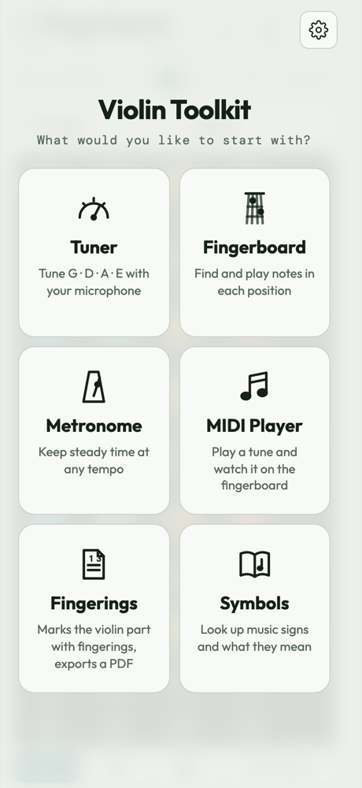
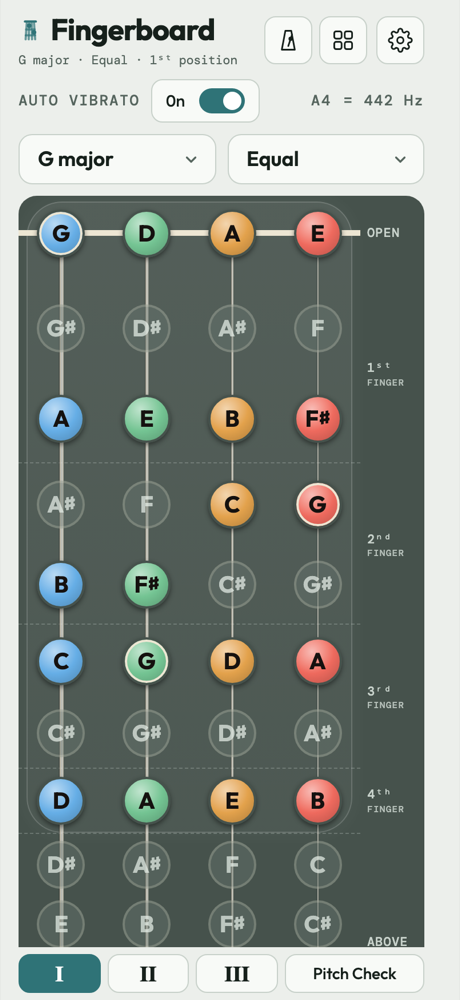
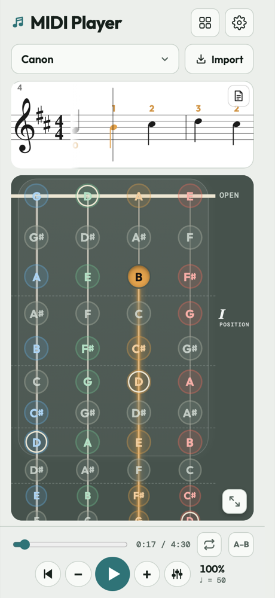
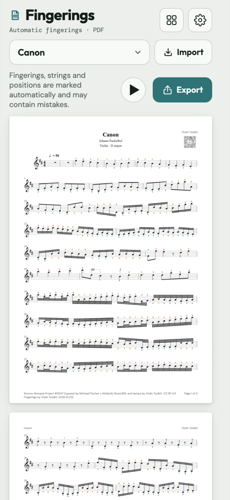
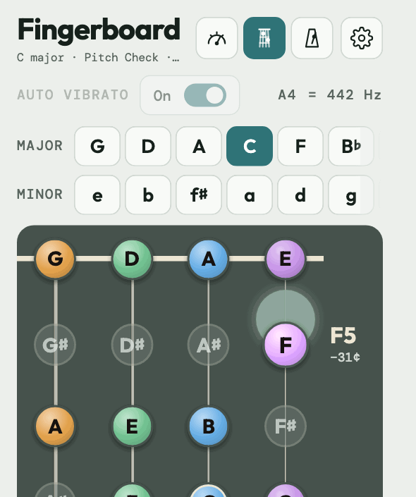

# 🎻 小提琴工具箱 Violin Toolkit

**免费的小提琴练习应用：调音器、指板、节拍器、带 19 首曲目的 MIDI 播放器、可打印的指法谱和乐谱符号词典。**
无需账号，没有广告，可离线使用。支持网页、安卓和 iPhone。

### ▶ [打开应用](https://trix69.github.io/violin-toolkit/#zh) · [安卓应用](https://trix69.github.io/violin-toolkit/apk/violin-toolkit-android.apk) · [English](README.md)

  
  
  
  

## 工具

**调音器**
- 通过麦克风收音。小提琴模式自动识别你拉的是哪根弦（G · D · A · E）；半音模式可显示任何音。
- 指针和音分显示偏低或偏高，±3 音分以内变绿。
- 每根弦都有参考音。标准音 A4 可设为 380–470 Hz（415、430、440、442、443 一点即选）。

**指板**
- 全部 12 个大调和 12 个小调，音名按调号拼写，调外的音显示为灰色。
- 一、二、三把位，每个音标有所用的手指。可选平均律、纯律或五度相生律。
- 按住音符即可听到；按住 3 秒后松手也会继续发声，像音叉一样。
- **音准检查：** 拉一个音，所有能拉出这个音的弦上会出现一个圆盘：在音符上为准，偏下为偏高，偏上为偏低。

**节拍器**
- 40–250 BPM，可用表盘、− / + 按钮或敲击设定；任意拍号，每一拍可设重音或静音。
- 可选的节拍闪光（主题颜色）。在指板页面也会继续响。

**MIDI 播放器**
- 19 首内置曲目，从《小星星》到维瓦尔第《四季》，带伴奏（见[曲谱来源](docs/score-credits.md)）。
- 可导入自己的 MIDI 或 MusicXML 文件：小提琴声部在指板上亮起，其他声部一起伴奏。
- 滚动乐谱，自动标注指法、把位、弓法和力度。预备拍、速度 50–150 %、循环、A–B 反复、混音（小提琴、伴奏、节拍器）、全屏。

**指法谱**
- 把任何曲子排成 A4 页面，标好指法、弦和把位，并导出 PDF。

**乐谱符号**
- 135 个乐谱符号（音符、弓法、力度、速度、装饰音、反复记号……）。可搜索，点按查看含义。

**通用**
- 中文或英文，音名（C D E）或唱名（Do Re Mi）。浅色、深色或自动，五种主题颜色。
- 练习时间：每天使用工具的分钟数，以及练习过的天数。
- 每个工具首次使用时有简短提示（设置 › 帮助 › 再次显示提示）。

   
  音准检查：偏低时在音符上方，偏高时在下方，音准时显示绿色圆环。

## 获取应用

- **网页：** [trix69.github.io/violin-toolkit](https://trix69.github.io/violin-toolkit/#zh)。联网时打开一次，然后添加到主屏幕（iPhone/iPad：分享 → 添加到主屏幕；安卓 Chrome：安装应用；电脑：Chrome 或 Edge 的“安装”，Safari 的“添加到程序坞”）。之后可离线使用。
- **安卓：** [下载应用](https://trix69.github.io/violin-toolkit/apk/violin-toolkit-android.apk)（提示时允许浏览器安装应用）。Google Play 版本正在测试中。
- **iPhone：** App Store 版本即将推出，在此之前请使用网页版。

应用启动时会检查新版本，更新前会先询问（设置 › 自动检查更新）。

## 隐私

你的设置、练习时间和导入的文件都只保存在你的设备上；麦克风声音只在设备上分析，不会发送到任何地方。
应用只在两种情况下联网：检查新版本（会发送应用版本、应用类型和在设备上生成的一个随机数，用于统计各版本的使用量），以及在手机应用里首次播放某首内置曲目时下载它。没有账号，不使用 Cookie，没有广告。完整内容见[隐私政策](https://trix69.github.io/violin-toolkit/docs/privacy.html)。

## 快捷链接

在网址的 `#` 后面加上以下内容，用逗号分隔：`tuner`、`fingerboard`、`metronome`、`symbols`、`midi` 或 `fingerings` 直接打开对应工具；`zh` / `en` 选择语言；`solfege` / `letter` 选择唱名或音名。
例如 [`#fingerboard,zh,solfege`](https://trix69.github.io/violin-toolkit/#fingerboard,zh,solfege)。

## 支持

如果它对你的练习有帮助，给这个仓库点个 ⭐ 能让更多琴友找到它，也可以[请我喝杯咖啡](https://buymeacoffee.com/trinks)。
欢迎在 [Issues](https://github.com/trix69/violin-toolkit/issues) 提建议或报告问题。

## 从源码构建

见[英文说明](README.md#building-from-source)：`python3 src/release.py`，只需要 Python 3。

## 许可

代码采用 [MIT 许可](LICENSE)。内置字体（DM Sans、DM Mono、Outfit）沿用 SIL 开放字体许可（`src/fonts/OFL.txt`）。
内置曲目沿用各乐谱版本的许可（公有领域、CC0、CC BY 或 CC BY-SA），列于 [docs/score-credits.md](docs/score-credits.md) 及应用的“设置 › 帮助 › 曲谱来源”。
